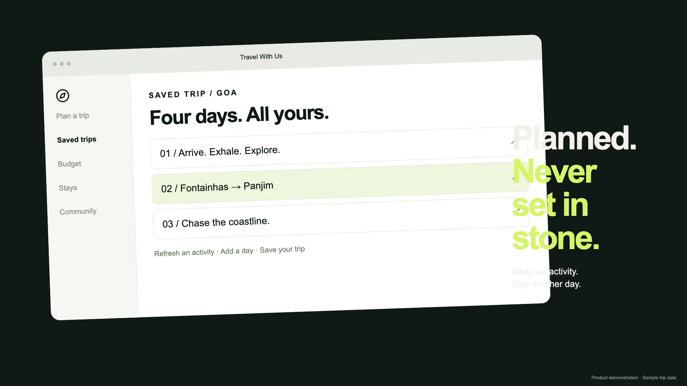

<div align="center">

# Travel With Us

### From “where next?” to a trip you can make your own.

Plan with AI. Keep your journeys, stays, budget, and essentials together.

[**Open the app →**](https://travellwithus.vercel.app) · [Video demos](#video) · [Features](#features) · [Run locally](#run-locally)

</div>

## Video

### See the journey in motion

A quick tour of trip planning, saved itineraries, stays, budgets, checklists, weather, and community.

[](docs/media/travel-with-us-demo.mp4)

**[▶ Watch the landscape demo · 15 seconds](docs/media/travel-with-us-demo.mp4)**

**[▶ Watch the mobile reel · 15 seconds](docs/media/travel-with-us-mobile.mp4)**

These are animated product demonstrations with illustrative destinations, prices, weather, and conversations. They are not live bookings or screen recordings. GitHub may open the videos as downloadable files; use the links above to view them.

Want to edit the films? See the [video source and rendering guide](remotion/README.md).

## Features

| | Feature | What you can do |
|---|---|---|
| 🗺️ | **AI trip planner** | Choose your destination, dates, budget, and starting point. Generate a day-by-day itinerary and refresh activities or entire days. Try planning without signing in. |
| 📅 | **Saved trips** | Save itineraries to your account, revisit activities, edit costs, and manage your journeys. Travel cards are separate from destination-day numbering. |
| 💰 | **Budget tracker** | View AI estimates, journey costs, and additional cost rows together. See partial totals and budget overruns when estimates are missing. |
| 🛏️ | **Find stays** | Explore AI-suggested stays by destination and nightly budget, save favorites by trip, and choose a tentative stay. |
| ✅ | **Trip checklists** | Keep a separate checklist for each trip or use a general list. Add, complete, move, and delete tasks. |
| 🌤️ | **Weather** | Search city suggestions or use your location to view temperature, conditions, humidity, and wind from the navbar. |
| 💬 | **Travel community** | Share travel stories, photos, questions, and polls; like posts and join conversations. |
| 👤 | **Traveler profiles** | Sign in with Google or email and manage your traveler profile. |
| 📱 | **Mobile & installable** | Use responsive layouts, light and dark themes, and install the PWA from the navbar when supported. |

Planning estimates and suggested stays are not confirmed prices or reservations. Check availability and fares before booking.

## How it works

1. **Choose a place.** Set your route, departure and return dates, and total budget.
2. **Make the plan yours.** Review the itinerary, refresh ideas, and adjust estimates.
3. **Keep everything together.** Sign in to save the trip, shortlist stays, add costs, and prepare your checklist.

## Built with

**Frontend:** React · Vite · Tailwind CSS · Firebase Authentication & Firestore  
**Backend:** Python · FastAPI · HTTPX · AI provider routing  
**Experience:** Lottie animation · Remotion demo films · installable PWA

The browser sends production API requests through Vercel’s `/api` proxy to the Render backend. Provider credentials stay on the server. AI requests use model fallback, rate-limit tracking, and a bounded response cache.

## Run locally

### Frontend

```sh
npm install
npm run dev -- --port 3000
```

Configure Firebase in `.env.local` using the variable names referenced in [src/Firebase.js](src/Firebase.js). Set `VITE_API_URL=http://127.0.0.1:8000` to target the local backend, or use the development proxy configured in [vite.config.js](vite.config.js).

### Backend

```sh
cd backend
python3 -m venv .venv
source .venv/bin/activate
pip install -r requirements.txt
cp .env.example .env
uvicorn main:app --reload --host 127.0.0.1 --port 8000
```

Fill in the required server configuration in `backend/.env`. Keep credentials out of Git. Photo uploads require the Firebase Admin configuration described in [backend/COMMUNITY_PHOTOS.md](backend/COMMUNITY_PHOTOS.md).

### Checks

```sh
npm test
npm run build
backend/.venv/bin/python -m unittest discover -s backend/tests
```

## Deployment

- **Frontend:** [Vercel](https://travellwithus.vercel.app), configured in [vercel.json](vercel.json).
- **Backend:** Render, with the service configuration in [backend/render.yaml](backend/render.yaml).
- **Automatic deploys:** The Render Blueprint specifies deployments on commits to `master`. For a manually configured service, enable **Settings → Build & Deploy → Auto-Deploy → On Commit** in Render.
- **Health check:** `GET /api/health`.

The backend start command uses one worker and bounded concurrency to reduce memory pressure. See the [performance review](docs/PERFORMANCE_REVIEW.md) for measurements and remaining improvements.
